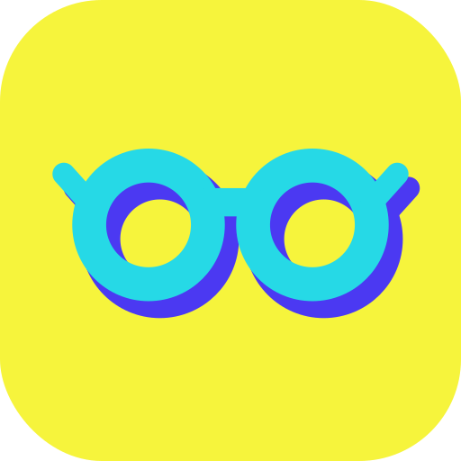

<div align="center">

<sub><b>AN INNOVATION STUDIO WITH A SIDEKICK SPIRIT &nbsp;·&nbsp; Two characters. One Idea-Man.</b></sub>

<br><br>

<a href="https://sergey9519546.github.io/idea-man/">
  
</a>

<br>

# Idea-Man

### **Every big idea needs a sidekick.**
**Insight first. Only ideas worth making.**

<p align="center">
  <i>Find distinct directions. Sharpen the strongest. Turn it into something you can make.</i>
</p>

[](https://sergey9519546.github.io/idea-man/)
[](#01--install)
[](#01--install)
[](https://github.com/sergey9519546/idea-man/releases/latest)
[](#license)

<p align="center">
  <a href="https://sergey9519546.github.io/idea-man/"><b>Live Site ↗</b></a> &nbsp;·&nbsp;
  <a href="#the-promise"><b>The Promise</b></a> &nbsp;·&nbsp;
  <a href="#01--install"><b>Install</b></a> &nbsp;·&nbsp;
  <a href="#02--modes"><b>Modes</b></a> &nbsp;·&nbsp;
  <a href="#03--skills"><b>11 Skills</b></a> &nbsp;·&nbsp;
  <a href="#04--voice"><b>Voice</b></a> &nbsp;·&nbsp;
  <a href="#05--character-system"><b>Characters</b></a>
</p>

</div>

---

## The Promise

<table>
<tr>
<td width="52%" valign="top">

<sub><b>THE PROMISE</b></sub>

### **Insight first. Only ideas worth making.**

**Idea-Man** is a free innovation and creative-director plugin for Claude and Codex. It understands the assignment, chooses useful thinking methods, and challenges weak ideas before you commit. Bring a business challenge, an engineering contradiction, a research question, an inefficient process, an everyday problem or a creative brief.

Independent thinkers and a separate critic join when your host supports and permits them; otherwise role passes are disclosed as sequential. Scores are optional judgments, not guarantees. Hard requirements and evidence govern which direction is ready for the next step.

Bring a half-formed thought, a rough draft, or a direction you already love. Idea-Man helps you find the next useful step—and carry the idea further.

<br>

**Site:** [**sergey9519546.github.io/idea-man ↗**](https://sergey9519546.github.io/idea-man/)

</td>
<td width="48%" valign="top">

<sub><b>A JOURNEY THAT FITS THE TASK</b></sub>

### **BIG IDEA. NEXT MOVE.**

 **`→`**  **`→`**  **`→`**  **`→`** 

1. **Understand** — Recover the real job, evidence and constraints. Preserve approved choices and the qualities that already work.
2. **Explore** — Research, diagnose or develop distinct mechanisms using the methods the task needs.
3. **Critique** — Compare usefulness, requirements, mechanisms and evidence. Surface weak assumptions and useful tradeoffs.
4. **Develop** — Sharpen the direction you choose without displacing approved decisions or constraints.
5. **Make** — Carry out authorized work with available tools, inspect the result, or prepare a clear handoff.

<sub><i>Need research, a decision, a precise edit or the finished work? Take the route that fits. Simple requests stay focused. Save project decisions locally when you authorize it.</i></sub>

</td>
</tr>
</table>

---

## 01 / Install

<table>
<tr>
<th width="36%" align="left">
  
</th>
<th width="32%" align="left">
  
</th>
<th width="32%" align="left">
  
</th>
</tr>
<tr>
<td valign="top">

Add the marketplace and install the plugin:

```bash
claude plugin marketplace add sergey9519546/idea-man
claude plugin install idea-man@idea-man-marketplace
```

Then run:

```text
/idea-man:creative-director <brief>
```

</td>
<td valign="top">

1. Open **Customize → Plugins → Add → Upload plugin**.
2. Download the published **plugin ZIP** from [**GitHub Releases ↗**](https://github.com/sergey9519546/idea-man/releases), then choose that ZIP.

<br>

[](https://github.com/sergey9519546/idea-man/releases/latest)

</td>
<td valign="top">

Add the plugin marketplace from `main`:

```bash
codex plugin marketplace add sergey9519546/idea-man --ref main
```

<br>

After registration, open Plugins, install Idea-Man from the registered marketplace, and start a new session. In Codex CLI, open `/plugins`.

<sub><i>Public-directory approval is separate; registering a marketplace alone does not activate the plugin. Marketplace submission remains on hold.</i></sub>

</td>
</tr>
</table>

---

## 02 / Modes

Start with the outcome in ordinary language; no mode is required. These optional modes change the depth and approach, while the actual task still governs.

<table>
<tr>
<td width="20%" valign="top">


### **Full**
Frame the assignment, explore useful directions, compare and develop as needed.

</td>
<td width="20%" valign="top">


### **Spark**
A quick burst of ideas.

</td>
<td width="20%" valign="top">


### **Critique**
Rate, compare or kill an existing idea.

</td>
<td width="20%" valign="top">


### **Unstick**
Get moving on a stuck problem.

</td>
<td width="20%" valign="top">


### **Room**
Independent thinkers and critique where host agents are available; otherwise disclosed sequential role passes.

</td>
</tr>
</table>

---

## 03 / Skills

**11 specialized skills** spanning innovation, research, decisions and creative work. The conductor selects the useful specialists; you can also invoke one directly:

Seventeen thinking methods cover reframing, inversion, subtraction, analogy, systems reasoning, first principles, contradiction resolution and experiments. Use what helps the assignment; no fixed method count or score ceremony is required.

| Studio Stage | Skills | Role in the Studio |
| :--- | :--- | :--- |
|  | <kbd>creative-director</kbd> <kbd>creative-brief</kbd> <kbd>research-and-writing</kbd> <kbd>innovation-strategy</kbd> | Orchestrate the room, sharpen the brief, synthesize research, and set strategy. |
|  | <kbd>concept-variations</kbd> | Generate distinct directions that change the idea—not just the wording. |
|  | <kbd>creative-review</kbd> <kbd>artifact-quality</kbd> | Compare usefulness, evidence, tradeoffs and hard requirements; inspect the actual deliverable. |
|  | <kbd>concept-development</kbd> <kbd>creative-learning</kbd> | Build around approved strengths; apply explicit feedback with its scope and exceptions. |
|  | <kbd>execution-handoff</kbd> | Produce the authorized result or prepare a concrete handoff with the available tools. |
|  | <kbd>creative-project</kbd> | Save authorized local decisions, preserve history, and resume from inspected project records. |

<details>
<summary><b>View flat list of all 11 skills</b></summary>
<br>

`creative-director`, `creative-brief`, `concept-variations`, `concept-development`, `creative-review`, `artifact-quality`, `research-and-writing`, `innovation-strategy`, `creative-learning`, `execution-handoff`, `creative-project`.

</details>

---

## 04 / Voice

<table>
<tr>
<td width="42%" valign="top">

<sub><b>04 / VOICE</b></sub>

### **Curious. Candid. Useful.**

A sharp creative partner with a sense of play. Ask the question that matters. Explain the choice. Give the person something they can use.

<br>

> *Keep the superhero spirit in the imagery. In conversation, use plain language and honest judgments.*

</td>
<td width="58%" valign="top">

| Stage | Studio Voice |
| :--- | :--- |
|  | **“Give me the rough version.”** |
|  | **“Six directions. Each changes the idea, not just the wording.”** |
|  | **“The hook works. The payoff needs a clearer turn.”** |
|  | **“Keep the part you love. Let's build the next piece around it.”** |

</td>
</tr>
</table>

---

## 05 / Character System

**Same mind. Two ways to show up.** Both characters are approved peers. Pick the silhouette that best fits the composition; their roles are flexible. Use either character—keep the attitude, the palette, and the glasses.

<table>
<tr>
<td width="50%" valign="top">

 &nbsp; 

### **Let curiosity lead.**
*Curiosity, with a cape.*

The empty glasses make room for the person with the idea. A compact, unusual silhouette for discovery and conversation. The glasses alone form the small composer mark.

* Round cyan glasses with violet depth; empty lenses.
* Coral cape, violet lining, and cyan clasp.
* No head, face, body, hands, or feet.

</td>
<td width="50%" valign="top">

 &nbsp; 

### **Give the idea presence.**
*A bright thought, ready to move.*

The confident pose makes a natural companion for demonstrations, studio guides, and moments when a direction starts taking shape.

* Plain cyan-blue bulb and round violet glasses.
* Coral cape, violet screw base, hands on hips, and boots.
* No eyes, eyebrows, mouth, filament, or light rays.

</td>
</tr>
<tr>
<td width="50%" valign="top">

**Give the silhouette space.**
Use the supplied full-square artwork. Keep both lenses and the cape visible. Avoid stretching, extra props, or placing copy over the character.

</td>
<td width="50%" valign="top">

**Make one character the focal point.**
Show the duo in brand introductions. Use the glasses mark for small composer placements and full illustrations for large placements. These mascots identify Idea-Man; the user's project keeps its own identity.

</td>
</tr>
</table>

<details>
<summary><b>🔍 The small-size check (32 px · 48 px · 64 px · 96 px icon scale preview)</b></summary>
<br>

At small sizes, judge the glasses mark, not illustration texture. Use the supplied `icon.png` yellow tile for the composer. Keep the full characters for large placements; never squeeze the duo or the wordmark into a tiny icon.

<table>
<tr>
<td align="center" width="25%">
  <br>
  <code>32 px</code>
</td>
<td align="center" width="25%">
  <br>
  <code>48 px</code>
</td>
<td align="center" width="25%">
  <br>
  <code>64 px</code>
</td>
<td align="center" width="25%">
  <br>
  <code>96 px</code>
</td>
</tr>
</table>

</details>

---

## 06 / Color & Typography

**Turn the volume up. Keep the message clear.** Yellow sets the stage. Deep violet carries the words. Cyan and coral bring the characters to life.

<table>
<tr>
<td width="20%" align="center" valign="top">
  <br>
  <sub><b>Signature field</b><br>Use Deep violet text</sub>
</td>
<td width="20%" align="center" valign="top">
  <br>
  <sub><b>Curiosity</b><br>Use Deep violet text</sub>
</td>
<td width="20%" align="center" valign="top">
  <br>
  <sub><b>Energy</b><br>Use Deep violet text</sub>
</td>
<td width="20%" align="center" valign="top">
  <br>
  <sub><b>Accent</b><br>Use White text</sub>
</td>
<td width="20%" align="center" valign="top">
  <br>
  <sub><b>Type &amp; depth</b><br>Use White text</sub>
</td>
</tr>
</table>

<details>
<summary><b>📐 Typography &amp; Contrast Rules (BIG IDEA. NEXT MOVE.)</b></summary>
<br>

* **Contrast:** Use deep violet (`#25134D`) for text on yellow, cyan, coral, and light neutral surfaces (`#FFFEF4`). Use white on electric (`#4B39F2`) or deep violet (`#25134D`). Keep electric violet and coral away from small text on each other. The artwork contains its own luminous yellow and shading—keep the supplied pixels intact.
* **Headlines:** `Arial Black`, with `Segoe UI Black` and a heavy sans-serif fallback (`Display 56–120 px`, `Section 32–64 px`). Short phrases, normal tracking so letters never touch, generous surrounding space.
* **Reading:** `Segoe UI`, then `Arial` or a system sans-serif (`Body 16–20 px`). Sentence case, comfortable line spacing, and short paragraphs.
* **Brand name:** **Idea-Man** in the wordmark and prose. Tagline: **“Every big idea needs a sidekick.”** Product line: **“Insight first. Only ideas worth making.”** Listing subtitle: **“Better ideas, clear next steps.”**

</details>

---

## Repository layout

```text
idea-man/
├── plugins/idea-man/    # The plugin (manifest, skills, prompts, and character assets)
├── site/                # Landing-page source (node site/build.mjs, then node site/validate.mjs)
├── docs/                # Compiled landing-page output for GitHub Pages
├── tests/               # Python behavior and integrity regressions
└── eval/                # Offline comparison harness and worked examples
```

* **`plugins/idea-man/`**: the plugin
* **`site/`**: landing-page source (`node site/build.mjs`, then `node site/validate.mjs`), output in `docs/` for GitHub Pages
* **`tests/`**: Python tests

---

## Release and local development

This working tree prepares **v1.2.3**. Published ZIPs are listed on [GitHub Releases](https://github.com/sergey9519546/idea-man/releases); installed copies receive changes only through a separate update. Marketplace submission remains on hold.

Version 1.2.3 strengthens task-fit routing, evidence and selection checks, recovery, constraint-preserving handoffs and portable project exports. Current goals and constraints come from available context and inspected sources. Authorized local records support return visits; Idea-Man does not recover unseen conversations or guarantee drift-free behavior.

The optional [candidate contract](plugins/idea-man/skills/creative-director/references/candidate-decisions.md) separates hard requirements, shared mechanisms, tradeoffs and readiness for the specific next commitment. It validates host-supplied judgments and grants no execution authority. Python helpers require Python 3.9+ and only the standard library; ordinary skill use does not require Python.

### Updating an existing installation

Claude Code: `claude plugin update idea-man@idea-man-marketplace`, then restart. In Codex, refresh the registered marketplace with `codex plugin marketplace upgrade <configured-marketplace-name>`, apply the available plugin update in Plugins, and start a new session.

### Build and check the site

```bash
node site/build.mjs
node site/validate.mjs
```

The public site excludes the brand-kit page. Approved artwork remains in the plugin package; regenerate `docs/` from `site/` sources.

### Evidence and worked examples

The [offline comparison harness](eval/README.md) checks supplied actual captures and supports blinded reviews. Passing local tests does not establish model-quality superiority, automatic activation or installed-host execution.

Three authored synthetic examples show diagnosis, decision sensitivity and pilot review with checked arithmetic and actual local readiness-helper results. They are not captured model runs or evidence of superiority. Read [the worked-example record](eval/examples/README.md); reproduce with `python eval/worked_examples.py --check`. The [site evidence page](https://sergey9519546.github.io/idea-man/evidence/) links the complete record, source conversations and evidence limits.

---

## License

**MIT.** Not affiliated with or endorsed by Anthropic or OpenAI.

<details>
<summary><b>Design references &amp; provenance</b></summary>
<br>

The source studies below informed the earlier exploration of recognizable marks and coherent brand systems. The final characters and palette follow the approved Idea-Man direction. These references are not evidence of conversion or marketplace ranking.

* [Canva identity study ↗](https://www.canva.com/newsroom/news/new-logo-canva/)
* [Figma brand guidance ↗](https://www.figma.com/using-the-figma-brand/)
* [OpenAI plugin guidelines ↗](https://developers.openai.com/plugins/plugin-guidelines)
* [OpenAI submission guidance ↗](https://developers.openai.com/plugins/deploy/submission)

</details>

<br>

<div align="center">
  <sub><b>Idea-Man</b> &nbsp;·&nbsp; Every big idea needs a sidekick. &nbsp;·&nbsp; <a href="#idea-man">Back to top ↑</a></sub>
</div>
